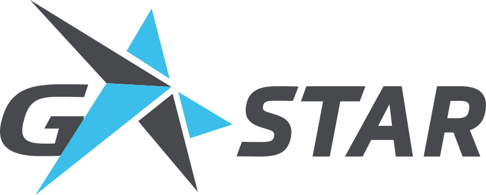
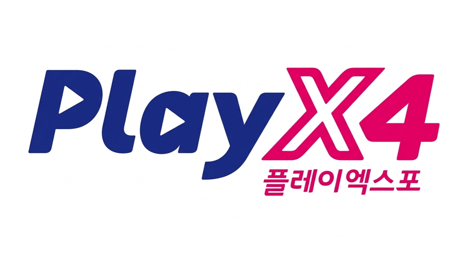
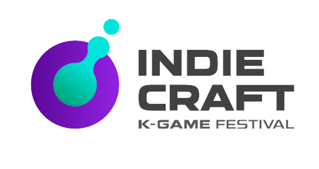
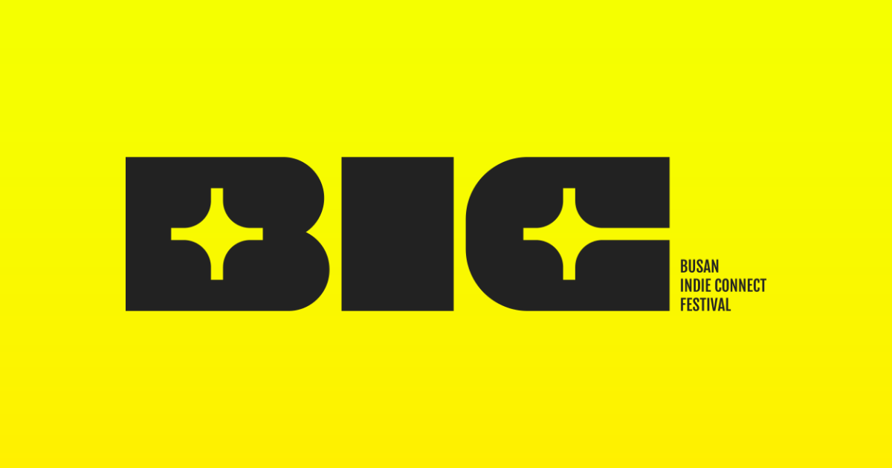
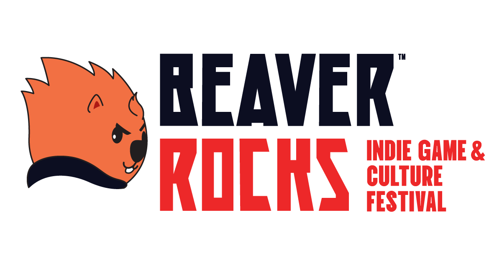
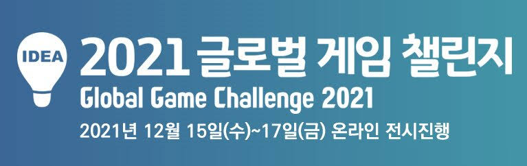
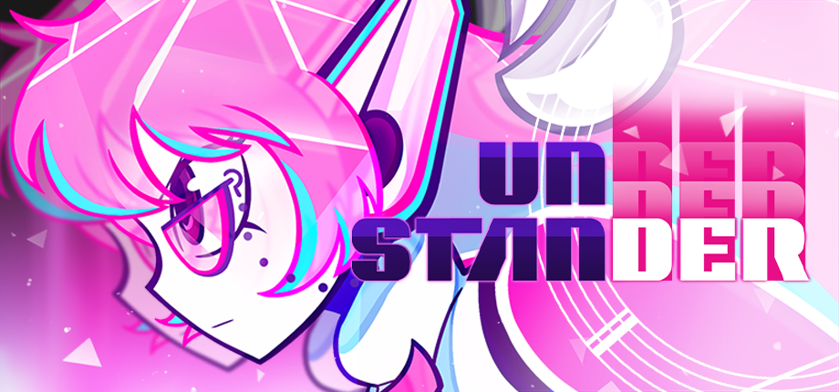
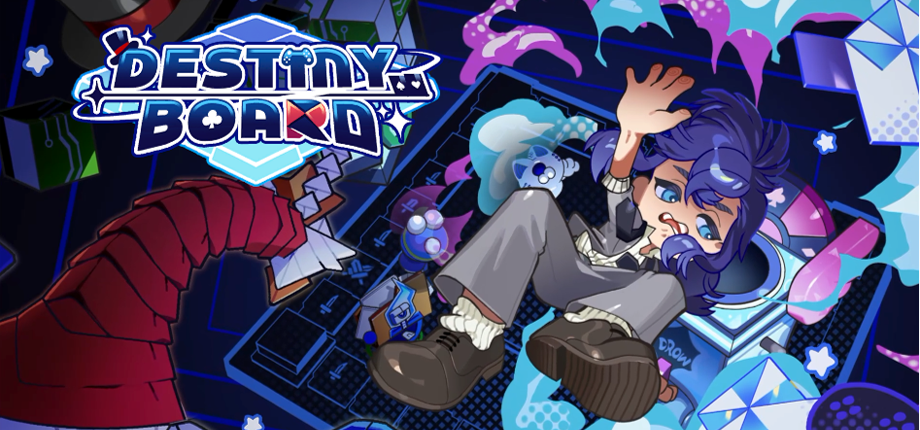

<h1>JANG YOUNGHO</h1>

<h3>Unity Client Programmer</h3>

<b>확장 가능하고 유지보수하기 좋은 게임 시스템을 설계하는 Unity 클라이언트 프로그래머</b>

---

## 🏆 수상 · 선정 · 전시

<table width="100%">
  <tr>
    <td width="33%" align="center">
      
       
      <b>2026 G-STAR</b>
       
      인디 쇼케이스 2.0: Galaxy
    </td>
    <td width="33%" align="center">
      
       
      <b>2026 PlayX4</b>
       
      인디오락실 선정 및 전시
    </td>
    <td width="33%" align="center">
      
       
      <b>2026 인디크래프트</b>
       
      챌린저 부문 TOP 20
    </td>
  </tr>
  <tr>
    <td width="33%" align="center">
      
       
      <b>BIC Festival 2025</b>
       
      루키 부문 선정 및 전시
    </td>
    <td width="33%" align="center">
      
       
      <b>2025 비버롹스</b>
       
      온라인 선정 및 전시
    </td>
    <td width="33%" align="center">
      
       
      <b>GGC 2021</b>
       
      Lacapium · 동상
    </td>
  </tr>
</table>

---

## 🎮 주요 프로젝트

### Understander

> 2D 횡스크롤 액션 어드벤처 · 팀 프로젝트 · 클라이언트 프로그래머 · 5인 팀  
> 2024.09 ~ 현재

플레이어 액션, 이벤트 기반 시스템 통신, 스테이지 진행, Enemy / Boss 전투 시스템을 구현했습니다.

`Player FSM` · `Generic EventBus` · `Ability / Rhythmic Combat` · `Stage System` · `Enemy / Boss Combat`

[프로젝트 포트폴리오](https://github.com/dudgh7052/Understander-Portfolio) ·
[STOVE](https://store.onstove.com/ko/games/101948) ·
[Steam](https://store.steampowered.com/app/4519300/Understander_Demo/) ·
[Gameplay](https://youtu.be/NLIcGpjQTtA?si=hyCTPXRmZhicE5su)

---

### DestinyBoard

> 2D 탑다운 액션 로그라이트 · 졸업작품 · 클라이언트 프로그래머 · 6인 팀  
> 2025.09 ~ 현재

분석 기반 플레이어 전투, 일반 적·보스 AI, 전투 VFX와 Feedback 시스템을 구현했습니다.

`Analysis Combat` · `Behavior Tree AI` · `VFX Pooling` · `Feedback System`

[프로젝트 포트폴리오](https://github.com/dudgh7052/DestinyBoard-Portfolio) ·
[Gameplay](https://youtu.be/yLrEhASMjsk)

---

## 📫 연락처

Email · `wkd7052@gmail.com`  
GitHub · [github.com/dudgh7052](https://github.com/dudgh7052)
